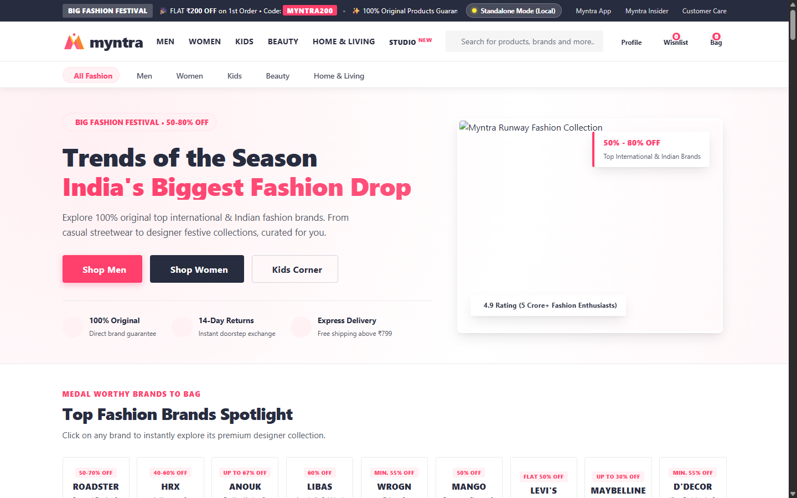
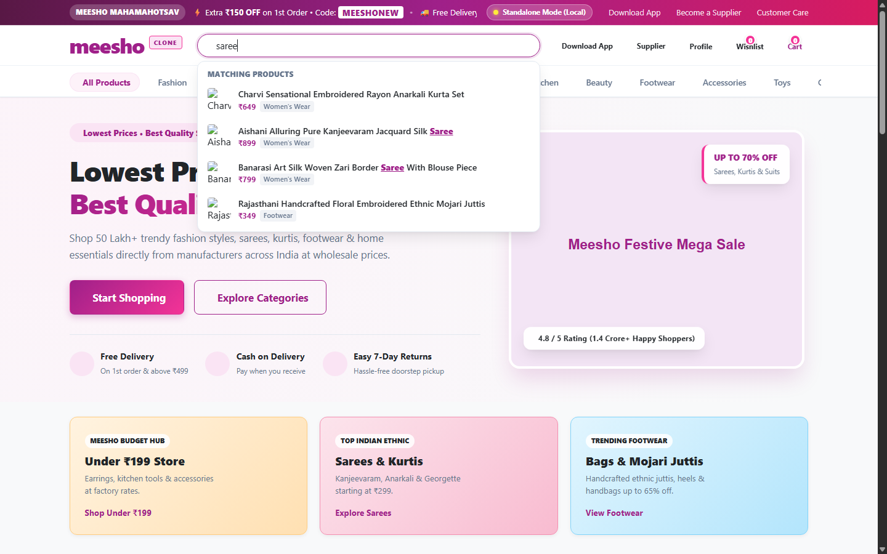

# MYNTRA FASHION – Full-Stack Fashion E-Commerce Web Application

> **Project Type:** B.Tech CSE Capstone Project Demonstration  
> **Student Name:** Rishabh Kumar  
> **Degree / Branch:** Bachelor of Technology (B.Tech) – Computer Science & Engineering  
> **Academic Session:** 2026  
> **Technology Stack:** HTML5, CSS3, Vanilla JavaScript (ES6+), Node.js (v24+), Express.js, SQLite (`node:sqlite`)  
> **Architecture:** 3-Tier Full-Stack Architecture with Dual-Mode Execution (SQLite + LocalStorage Fallback)  
> **Repository:** [krishabh7928-jpg/myntra-fashion-ecommerce](https://github.com/krishabh7928-jpg/myntra-fashion-ecommerce)  
> **Academic Presentation:** [Myntra_Fashion_BTech_Project_Presentation.pptx](Myntra_Fashion_BTech_Project_Presentation.pptx)  
> **Viva Preparation Guide:** [Myntra_Project_Viva_Preparation.docx](Myntra_Project_Viva_Preparation.docx)

---

## 1. Project Overview

**MYNTRA FASHION – Full-Stack Fashion E-Commerce Web Application** is an academic full-stack lifestyle shopping web application inspired by modern Indian fashion e-commerce design. It catalogs **75 fashion products** across **5 core departments** and **56 brands**, paired with a lightweight Express.js REST API and an embedded SQLite database (`data/fashion.db`).

### Key Objectives
- **Fashion-Focused Storefront UI/UX:** Implement a clean visual hierarchy using a Myntra-inspired coral-pink (`#ff3f6c`) and charcoal slate (`#282c3f`) palette, 3:4 portrait product cards, rating badges, and a sticky mobile bottom navigation bar.
- **Multi-Faceted Catalog Discovery:** Support simultaneous filtering by **Category**, **Brand**, **Size**, **Price Range**, **Quick-View Tabs**, and **Sort Order**.
- **Smart Multi-Token Search:** Provide debounced live autocomplete suggestions with brand-priority weighting and matched-token highlighting.
- **Dual-Mode Execution:** Connect seamlessly to Node.js + Express + SQLite when the server is running, and fall back to browser `localStorage` + `products_data.js` when opened directly via `index.html`.

---

## 2. Features

- **5 Fashion Departments:** Dedicated browsing for **Men**, **Women**, **Kids**, **Beauty**, and **Home & Living**.
- **Top Brands Spotlight & 56-Brand Filter:** Interactive homepage spotlight tiles (`Roadster`, `HRX by Hrithik Roshan`, `Anouk`, `Libas`, `WROGN`, `Mango`, `Levis`, `Maybelline New York`, `D'Decor`) plus a complete 56-brand filter dropdown.
- **Multi-Faceted Filtering & Sorting:** Filter concurrently by Category, Brand, Apparel Size (`S`–`XXL`, `Free Size`, and numeric sizes), Price Range (`Under ₹500`, `₹500 - ₹999`, `₹1,000 - ₹1,999`, `₹2,000 & Above`), Quick-View tabs (`All Styles`, `Trending`, `Best Sellers`, `50%+ OFF`, `Under ₹999`), and Sort (`Recommended`, `Price: Low to High`, `Price: High to Low`, `Customer Rating`, `Better Discount`, `What's New`).
- **Quick View Modal:** Displays product photography, brand, ratings, discount details, interactive size selector, quantity stepper, stock indicator, and Wishlist toggle.
- **Slide-Over Shopping Bag & Wishlist Drawers:** Size-aware cart items, quantity increment/decrement, remove actions, ₹799 Free Delivery progress bar, and Wishlist Move-to-Bag support.
- **Promo Coupon Engine:** Supports `MYNTRA200` (Flat ₹200 OFF above ₹799), `MYNTRA10` (10% OFF above ₹499), `FESTIVE20` (20% OFF above ₹599), `FIRST100` (Flat ₹100 OFF above ₹499), and `FREEDEL` (Free Delivery).
- **Simulated Checkout & Profile Modal:** Client-side validation for full name, 10-digit Indian mobile number, 6-digit PIN code, address, city, and state; Cash on Delivery (COD) / UPI demo selection; unique Order ID generation; and **My Orders**, **Saved Addresses**, and **Myntra Coupons** tabs in the Profile modal.
- **Responsive Design:** Adapts across Desktop (`1440px`, 4 columns), Tablet (`1024px`, 3 columns; `768px`, 2 columns), and Mobile (`390px`, 2 columns + bottom navigation dock).

---

## 3. Screenshots

| Desktop Homepage | Smart Search Autocomplete |
| :---: | :---: |
|  |  |

| Catalog Grid | Slide-Over Bag Drawer | Mobile Responsive View |
| :---: | :---: | :---: |
|  |  |  |

---

## 4. Technologies Used

| Layer | Technology | Purpose |
| :--- | :--- | :--- |
| **Frontend Markup** | HTML5 | Semantic layout (`header`, `nav`, `section`, `article`, `footer`), modals, and slide-over drawers |
| **Frontend Styling** | CSS3 | Custom properties, CSS Grid, Flexbox, and responsive breakpoints (`1024px`, `768px`, `480px`) |
| **Client Logic** | Vanilla JavaScript (ES6+) | Dual-mode sync, multi-faceted filtering, smart search, cart/wishlist state, and form validation |
| **Backend Runtime** | Node.js (**v24+ required**) | Executes Express server and provides built-in `node:sqlite` (`DatabaseSync`) |
| **Web Framework** | Express.js (`^4.21.2`) + `cors` | Static asset serving and RESTful JSON API routes |
| **Database** | SQLite (`data/fashion.db`) | Serverless embedded relational database (5 tables) |
| **Offline Storage** | HTML5 `localStorage` | Client-side persistence for cart, wishlist, saved addresses, and orders in Standalone Mode |
| **Documentation Tools** | `pptxgenjs` (`^3.12.0`) | Generates the 14-slide academic PowerPoint presentation |

---

## 5. System Architecture

The application follows a **3-Tier Architecture** with **Dual-Mode Execution**:

1. **Presentation Tier (`index.html`, `style.css`, `script.js`, `products_data.js`):** Renders the storefront in the browser and probes `GET /api/health` on load.
2. **Application Tier (`server.js`):** Express.js REST API handling catalog queries, search suggestions, session-scoped cart/wishlist updates (`x-session-id`), coupon validation, and order creation.
3. **Database Tier (`db.js`, `data/fashion.db`):** SQLite database managed via Node.js v24 `DatabaseSync`.

### Supported Execution Modes
- **Full-Stack Mode (`node server.js`):** When `/api/health` succeeds, the header badge shows `Full-Stack Mode (SQLite)` and operations sync with `data/fashion.db`.
- **Standalone Mode (`index.html`):** When opened directly in a browser without running Node.js, the header badge shows `Standalone Mode (Local)` and the app runs using `products_data.js` and browser `localStorage`.

---

## 6. Installation & Execution

### Prerequisites
- **[Node.js](https://nodejs.org/) v24 or higher** (required for built-in `node:sqlite` `DatabaseSync`; verified on **Node v24.22.0**)
- A modern web browser (Google Chrome, Microsoft Edge, or Mozilla Firefox)

### Option 1: Full-Stack Mode (Node.js + Express + SQLite)
1. Clone the repository and open the project directory:
   ```bash
   git clone https://github.com/krishabh7928-jpg/myntra-fashion-ecommerce.git
   cd myntra-fashion-ecommerce
   ```
2. Install dependencies:
   ```bash
   npm install
   ```
3. Start the server:
   ```bash
   node server.js
   ```
   *(Or run `npm start`.)*
4. Open in your browser:
   ```text
   http://localhost:5000
   ```

### Option 2: Standalone Mode (Browser Only)
1. Open `index.html` directly in a web browser (or via a static file server).
2. Confirm the top-bar indicator displays `Standalone Mode (Local)`.

---

## 7. Project Directory Structure

```text
myntra-fashion-ecommerce/
├── index.html                                    # Semantic HTML5 markup, modals & drawers
├── style.css                                     # Myntra-inspired CSS3 design system & responsive rules
├── script.js                                     # Client state, search, filters, cart, wishlist & dual-mode sync
├── products_data.js                              # 75 curated fashion products across 5 departments
├── server.js                                     # Express.js static server & REST API endpoints
├── db.js                                         # SQLite schema initialization, seeding & query helpers
├── data/
│   └── fashion.db                                # Embedded SQLite database file
├── screenshots/                                  # Live browser screenshots (desktop & mobile)
├── capture_all_screenshots.js                    # Automated headless Chrome screenshot script
├── generate_ppt.js                               # 14-slide academic PowerPoint generator script
├── Myntra_Fashion_BTech_Project_Presentation.pptx # Final 14-slide B.Tech project presentation
├── Myntra_Project_Viva_Preparation.docx          # Viva preparation notes & 15 Q&As
├── test_e2e.js                                   # End-to-end backend/database test suite
├── audit_suite.js                                # Architecture, schema & API logic audit suite
├── final_verification_suite.js                   # System functionality & HTTP API verification suite
├── verify_all_improvements.js                    # Brand, size, search & persistence verification suite
├── package.json                                  # Project metadata, scripts & Node >=24 engine requirement
├── package-lock.json                             # Locked dependency tree
├── vercel.json                                   # Deployment routing configuration
└── README.md                                     # Project documentation
```

---

## 8. Database Schema (`data/fashion.db`)

SQLite initializes **5 tables** in `db.js`:

1. **`products`** — `id` (PK), `name`, `brand`, `category`, `price`, `original_price`, `discount`, `rating`, `reviews_count`, `image`, `description`, `sizes` (JSON), `popularity`, `stock`, `badge`, `tags`, `created_at`
2. **`orders`** — `id` (PK), `order_id` (UNIQUE), `order_date`, `customer_name`, `customer_phone`, `customer_address`, `payment_method`, `total_amount`, `items_json`
3. **`cart_items`** — `id` (PK), `session_id`, `product_id`, `quantity`, `size`, `UNIQUE(session_id, product_id)`
4. **`wishlist_items`** — `id` (PK), `session_id`, `product_id`, `UNIQUE(session_id, product_id)`
5. **`coupons`** — `code` (PK), `discount`, `type`, `min_order`, `description`

---

## 9. REST API Endpoints

| Method | Endpoint | Parameters / Body | Purpose |
| :--- | :--- | :--- | :--- |
| `GET` | `/api/health` | None | Returns server status and active database driver (`sqlite`) |
| `GET` | `/api/products` | `?category, brand, size, priceMin, priceMax, search, sort, viewFilter` | Returns filtered and sorted product catalog |
| `GET` | `/api/brands` | None | Returns unique brand names and product counts |
| `GET` | `/api/categories` | None | Returns department names and product counts |
| `GET` | `/api/products/suggestions` | `?q=...&limit=6` | Returns autocomplete matches for products, brands, and categories |
| `GET` | `/api/products/:id` | Route param `id` | Returns a single product by ID (`404` if not found) |
| `GET` / `POST` | `/api/cart` | Header `x-session-id`; Body `{ productId, quantity, size }` | Fetches or adds items to session cart |
| `PUT` / `DELETE` | `/api/cart/:productId` | Header `x-session-id`; Body `{ delta }` | Updates item quantity or removes item from session cart |
| `GET` / `POST` | `/api/wishlist` | Header `x-session-id`; Body `{ productId }` | Fetches or toggles session wishlist item |
| `GET` / `POST` | `/api/orders` | Body `{ orderId, customer, paymentMethod, items, totalAmount }` | Validates order input, saves order in SQLite, or retrieves order history |
| `POST` | `/api/coupons/apply` | Body `{ code, orderAmount }` | Validates coupon code and returns computed discount |

---

## 10. Verified Test Results

All four project test suites run via Node.js:

```bash
node test_e2e.js
node audit_suite.js
node final_verification_suite.js
node verify_all_improvements.js
```

| Verification Suite | Verified Result | Scope Covered |
| :--- | :---: | :--- |
| `test_e2e.js` | **26 / 26 PASSED** | 75 products, discounts, size-aware cart CRUD, wishlist, coupons, SQLite orders |
| `audit_suite.js` | **36 / 36 PASSED** | 24 DOM elements, 5 SQLite tables, API filters, coupons, order persistence |
| `final_verification_suite.js` | **69 / 69 PASSED** | 5 departments, 56 brands, sizes, HTTP API routes, standalone data parity, checkout |
| `verify_all_improvements.js` | **37 / 37 PASSED** | Brand filters, multi-token search, suggestions, price sorting, SQLite persistence |
| **Total Automated Node Checks** | **168 / 168 PASSED** | **All checks passed across all 4 Node suites** |

Additionally, live headless Chrome browser E2E testing against `http://localhost:5000` passed **26 / 26** checks (homepage, search, filters, Quick View, cart, wishlist, coupon, checkout, Account modal tabs, multi-size cart, `390px`/`768px`/`1440px` responsive layouts, and zero console/JS/HTTP errors).

---

## 11. Author

- **Student:** Rishabh Kumar  
- **Degree:** Bachelor of Technology (B.Tech) – Computer Science & Engineering (CSE)  
- **Academic Session:** 2026  
- **GitHub:** [krishabh7928-jpg/myntra-fashion-ecommerce](https://github.com/krishabh7928-jpg/myntra-fashion-ecommerce)
