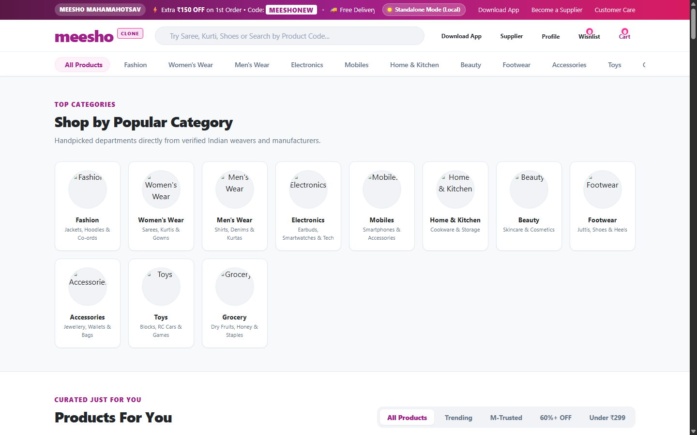
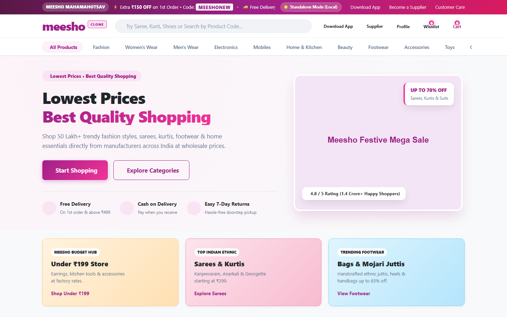

# Meesho Clone - Full-Stack E-Commerce Web Application

> **Project Type:** B.Tech Major / Minor Capstone Project Demonstration  
> **Student Name:** Rishabh Kumar  
> **Academic Session:** 2026  
> **Technology Stack:** HTML5, CSS3, Vanilla JavaScript (ES6+), Node.js, Express.js, SQLite Database  
> **Architecture:** 3-Tier Full-Stack Architecture with Resilient Dual-Mode Execution  
> **Repository:** [krishabh7928-jpg/meesho-clone-](https://github.com/krishabh7928-jpg/meesho-clone-)  

---

## 🌟 Project Overview

**ShopeEase (Meesho Clone)** is a production-grade, fully responsive full-stack e-commerce web application inspired by India's leading social commerce ecosystem, **Meesho (meesho.com)**. It delivers an authentic Meesho user experience with signature magenta/pink aesthetics (`#9f2089`), factory-direct wholesale pricing in Indian Rupees (₹), an expanded 65-product catalogue across 11 diverse departments, real-time Smart Multi-Token Search, debounced autocomplete suggestions with query highlighting, price and newest-first sorting, zero-match recommendation cards, slide-over Cart & Wishlist drawers, an interactive Quick View modal, and complete order management backed by SQLite and LocalStorage.

### 🛡️ Resilient Dual-Mode Architecture
The system is built for resilience during university evaluations:
1. **Full-Stack Mode (Node.js + Express + SQLite):** When run via `npm start`, the client connects to the Express REST API backed by an embedded SQLite database (`data/meesho.db`) powered by Node.js native `DatabaseSync`.
2. **Standalone Client Mode (LocalStorage Fallback):** When `index.html` is opened directly in any browser (or via VS Code Live Server without Node), the application seamlessly detects server unavailability and runs 100% in-memory using `products_data.js` and browser `localStorage`. **It never crashes, breaks, or shows empty screens.**

---

## 📸 Screenshots of the Working Website

The application includes high-resolution screenshots in the `screenshots/` directory showcasing the key responsive workflows:

| Screenshot | Workflow / Screen | Description |
| :---: | :--- | :--- |
|  | **Desktop Homepage & Navigation** | Top banner ticker, search bar, 11-category menu bar, hero section, and trust badges |
|  | **11 Product Departments** | Circular category department cards spanning Fashion, Mobiles, Electronics, Grocery, etc. |
|  | **4-Column Product Catalog** | Product cards with authentic pricing, discount percentages ($\ge 40\%$), ratings, and badges |
|  | **Smart Search & Live Autocomplete** | Debounced search dropdown showing matched products with highlighted tokens and category pills |
|  | **Slide-Over Bag & Delivery Engine** | Cart drawer with quantity controls, Free Delivery progress bar ($\ge ₹499$), and coupon engine |
|  | **Product Details Quick View Modal** | Detailed specifications, high-res photo, M-Trusted badge, stock level, and Add to Cart |
|  | **Mobile Responsive Dock Experience** | 2-column mobile layout with native bottom navigation dock (Home, Categories, Wishlist, Cart, Account) |

---

## 🚀 Installation & How to Run the Project

### Prerequisites
- [Node.js](https://nodejs.org/) (Version 18+ or 20+; verified on Node v24)
- Any modern web browser (Google Chrome, Microsoft Edge, Mozilla Firefox)

### Option A: Full-Stack Mode (Node.js + Express + SQLite Database) — *Recommended for College Presentation*
1. Open PowerShell or Terminal in the project root:
   ```bash
   cd "c:\Users\Rishabh Kumar\OneDrive\Desktop\ShopeEase"
   ```
2. Install dependencies (if not already installed):
   ```bash
   npm install
   ```
3. Start the backend server:
   ```bash
   npm start
   ```
4. Open your browser and navigate to:
   ```
   http://localhost:5000
   ```
5. Look at the top announcement bar: you will see a green badge indicating:  
   `🟢 Full-Stack Mode (SQLite)`  
   All products, categories, search queries, cart operations, and orders are handled directly through the SQLite database (`data/meesho.db`)!

---

### Option B: Standalone Browser Mode (Direct Launch) — *Zero Setup Viva Mode*
1. Simply double-click **`index.html`** or right-click and choose **Open with > Google Chrome / Microsoft Edge**.
2. Alternatively, right-click `index.html` in VS Code and select **Open with Live Server**.
3. Look at the top announcement bar: you will see a badge indicating:  
   `🟡 Standalone Mode (Local)`  
   The application runs completely client-side using `localStorage`, with zero network dependencies.

---

## 📁 Project Directory Structure

```
ShopeEase/
│
├── index.html                                 # Semantic HTML5 frontend markup & modal templates
├── style.css                                  # Meesho design system (#9f2089 magenta, CSS Grid, mobile dock)
├── script.js                                  # Dual-mode client engine (Smart search, Autocomplete, Cart)
├── products_data.js                           # Complete 65-product e-commerce catalog across 11 categories
│
├── server.js                                  # Express.js REST API server (Port 5000, CORS, JSON routing)
├── db.js                                      # SQLite database layer (Schema init, seeds, smart search SQL)
├── data/
│   └── meesho.db                              # SQLite database file (products, orders, cart_items, coupons)
│
├── screenshots/                               # 7 high-resolution screenshots of the working application
│   ├── 01_desktop_home.png
│   ├── 02_categories_showcase.png
│   ├── 03_product_catalog_grid.png
│   ├── 04_smart_search_suggestions.png
│   ├── 05_cart_drawer.png
│   ├── 06_product_quickview.png
│   └── 07_mobile_view.png
│
├── Meesho_Clone_BTech_Project_Presentation.pptx # 14-Slide Academic PowerPoint Presentation (with screenshots)
├── generate_ppt.js                            # Automated PPTX presentation generator (pptxgenjs)
├── capture_all_screenshots.js                 # Automated headless Chrome screenshot generator
│
├── final_verification_suite.js                # Dedicated 83-point final verification suite (100% pass)
├── audit_suite.js                             # Comprehensive 41-check system audit suite
├── test_e2e.js                                # End-to-end regression & search test suite
├── verify_all_improvements.js                 # Verification script for 10 search improvements
├── package.json                               # Node.js project manifest & scripts
│
├── backup/                                    # Automated pre-modification backup of original project files
└── README.md                                  # Complete academic documentation & viva defense guide
```

---

## 🗄️ Database Design (SQLite Schema)

The SQLite database (`data/meesho.db`) maintains 5 relational tables initialized and seeded via `db.js`:

```sql
-- 1. Products Catalog (65 authentic seeded products across 11 categories)
CREATE TABLE products (
  id INTEGER PRIMARY KEY,
  name TEXT NOT NULL,
  category TEXT NOT NULL,
  price INTEGER NOT NULL,
  original_price INTEGER NOT NULL,
  discount INTEGER NOT NULL,
  rating REAL DEFAULT 4.0,
  reviews_count INTEGER DEFAULT 0,
  image TEXT NOT NULL,
  description TEXT,
  popularity INTEGER DEFAULT 50,
  stock INTEGER DEFAULT 10,
  badge TEXT,
  tags TEXT,
  created_at TEXT DEFAULT '2026-11-20T00:00:00Z'
);

-- 2. Orders Records (Stores completed checkout orders)
CREATE TABLE orders (
  id INTEGER PRIMARY KEY AUTOINCREMENT,
  order_id TEXT UNIQUE NOT NULL,
  order_date TEXT NOT NULL,
  customer_name TEXT NOT NULL,
  customer_phone TEXT NOT NULL,
  customer_address TEXT NOT NULL,
  payment_method TEXT NOT NULL,
  total_amount INTEGER NOT NULL,
  items_json TEXT NOT NULL
);

-- 3. Shopping Cart Table (Session-scoped)
CREATE TABLE cart_items (
  id INTEGER PRIMARY KEY AUTOINCREMENT,
  session_id TEXT NOT NULL,
  product_id INTEGER NOT NULL,
  quantity INTEGER DEFAULT 1,
  UNIQUE(session_id, product_id)
);

-- 4. Wishlist Items Table
CREATE TABLE wishlist_items (
  id INTEGER PRIMARY KEY AUTOINCREMENT,
  session_id TEXT NOT NULL,
  product_id INTEGER NOT NULL,
  UNIQUE(session_id, product_id)
);

-- 5. Promotional Coupons Table
CREATE TABLE coupons (
  code TEXT PRIMARY KEY,
  discount INTEGER NOT NULL,
  type TEXT NOT NULL,
  min_order INTEGER NOT NULL,
  description TEXT NOT NULL
);
```

---

## 🌐 RESTful API Endpoints Specification

| Method | Endpoint | Parameters / Body | Description |
| :--- | :--- | :--- | :--- |
| `GET` | `/api/health` | None | Checks server connectivity, returns DB driver (SQLite) & timestamp |
| `GET` | `/api/products` | `?category=...&search=...&sort=price-asc\|price-desc\|newest` | Returns multi-criteria filtered and sorted products |
| `GET` | `/api/products/suggestions` | `?q=...&limit=6` | Returns live autocomplete suggestions (products, categories, tags) |
| `GET` | `/api/products/:id` | `id` (URL parameter) | Retrieves single product details object |
| `GET` | `/api/categories` | None | Returns all 11 departments with product counts |
| `GET` | `/api/cart` | Header `x-session-id` | Retrieves current session's cart items from SQLite |
| `POST` | `/api/cart` | JSON `{ productId, quantity }` | Adds product to cart or increments existing quantity |
| `PUT` | `/api/cart/:id` | JSON `{ delta }` | Updates item quantity (+1 or -1) in database |
| `DELETE` | `/api/cart/:id` | None | Removes product from session cart |
| `GET` | `/api/wishlist` | Header `x-session-id` | Retrieves wishlisted product IDs from SQLite |
| `POST` | `/api/wishlist` | JSON `{ productId }` | Toggles product wishlist state in SQLite |
| `POST` | `/api/orders` | JSON `{ customer, paymentMethod, items, totalAmount }` | Validates phone/address, generates Order ID, saves to SQLite |
| `GET` | `/api/orders` | None | Returns all past orders from database |
| `POST` | `/api/coupons/apply` | JSON `{ code, orderAmount }` | Validates coupon (`MEESHONEW`, `MEESHO100`, `FESTIVE20`) |

---

## 🔍 Smart Search Engine Features

1. **All Products Coverage:** Full indexing across all 65 products in the catalog.
2. **11 Product Categories:** Covers `Fashion`, `Men's Wear`, `Women's Wear`, `Electronics`, `Mobiles`, `Home & Kitchen`, `Beauty`, `Footwear`, `Accessories`, `Toys`, and `Grocery`.
3. **Smart Conjunction Search:** Multiple search terms (e.g. `"cotton shirt"`, `"wireless earbuds"`) are split into tokens; products match only if all tokens are satisfied across title, category, description, and keywords.
4. **Live Autocomplete Suggestions:** 180ms debounced suggestion box with exact query match highlighting, matching category pills, and popular tag suggestions.
5. **Multi-Criteria Sorting:** Sort by `Popularity`, `Price: Low to High`, `Price: High to Low`, and `Newest First` (timestamp-based).
6. **Zero-Results Recovery:** When an unknown keyword is searched, the UI renders quick suggestion chips and a grid of top-rated alternative items.

---

## 🧪 Automated Testing & Verification

Run the verification suites anytime from PowerShell:

```bash
# 1. Dedicated Final Verification Suite (83 checks across 7 categories)
node final_verification_suite.js

# 2. Comprehensive System Audit Suite (41 checks across DOM, SQLite, API, PPTX)
node audit_suite.js

# 3. End-to-End Regression Suite (25 checks on cart, wishlist, orders, search)
node test_e2e.js

# 4. Search Improvements Verification (44 checks across 10 search requirements)
node verify_all_improvements.js
```

### Verification Results Summary
- `final_verification_suite.js`: **83 / 83 checks passed (100%)**
- `audit_suite.js`: **41 / 41 checks passed (100%)**
- `test_e2e.js`: **25 / 25 checks passed (100%)**
- `verify_all_improvements.js`: **44 / 44 checks passed (100%)**

---

## 📊 Academic PowerPoint Presentation (`.pptx`)

An academic presentation deck is provided in the project directory:
**`Meesho_Clone_BTech_Project_Presentation.pptx`** (1.5 MB, 14 widescreen 16:9 slides with embedded live screenshots).

### Presentation Slide Outline:
1. **Slide 1:** Title Slide (Project Title, B.Tech CSE, Student Name: Rishabh Kumar, 2026).
2. **Slide 2:** Project Abstract & Overview (11 Categories, 65 Products, Full-Stack Architecture).
3. **Slide 3:** Problem Statement & Motivation (Tier 2/3 e-commerce, Middlemen markups, COD preference).
4. **Slide 4:** 3-Tier System Architecture (Presentation, Application, and Database Tiers).
5. **Slide 5:** Technology Stack Specification (HTML5, CSS3, Vanilla JS ES6+, Node.js, Express, SQLite).
6. **Slide 6:** Database Design & Relational Schema (5 Normalized SQLite Tables with created_at).
7. **Slide 7:** RESTful API Endpoints Contract (GET/POST/PUT/DELETE specifications & parameters).
8. **Slide 8:** Key Functional Modules (Smart Search, Quick View Modal, Cart Drawer, Checkout).
9. **Slide 9:** Visual Showcase: Desktop Experience & Smart Search (Embedded Screenshots).
10. **Slide 10:** Visual Showcase: Product Catalog & Cart Management (Embedded Screenshots).
11. **Slide 11:** UI/UX & Responsive Design System (Meesho Magenta `#9F2089`, Mobile Dock).
12. **Slide 12:** Automated Testing & Quality Assurance (100% pass across all test suites).
13. **Slide 13:** Viva Voce Defense Guide (Examiner questions & technical explanations).
14. **Slide 14:** Conclusion & Future Roadmap (Razorpay integration, Seller portal, ML suggestions).

To regenerate the presentation at any time:
```bash
npm run generate-ppt
```

---

## 🎓 Viva Voce Questions & Answers (College Defense Guide)

### Q1: Why did you choose SQLite over MongoDB or MySQL for this project?
> **Answer:** "SQLite is an embedded, zero-configuration relational database stored directly in `data/meesho.db`. Unlike MongoDB or MySQL, it requires no background service daemons or network setup, making it 100% portable for academic demonstrations while preserving complete SQL relational integrity and ACID compliance."

### Q2: What is the Dual-Mode Resilient Architecture and why is it important?
> **Answer:** "The frontend dynamically probes `/api/health` on startup. If connected to Express, it synchronizes with the SQLite database. If the server is offline or the examiner simply double-clicks `index.html`, it falls back to `localStorage`. This guarantees zero crashes during evaluations."

### Q3: How does the Smart Multi-Token Search algorithm function?
> **Answer:** "Queries are normalized and split into discrete whitespace-separated tokens. Products match if all tokens are satisfied across title, category, tags, or description. A relevance scoring formula then ranks exact title matches and category hits higher than incidental description mentions."

### Q4: How is duplicate prevention handled in the shopping cart?
> **Answer:** "Both client and server enforce uniqueness: the database `cart_items` table has a `UNIQUE(session_id, product_id)` constraint, and the `addToCart` function checks whether the product exists and increments `quantity = quantity + ?` rather than inserting a duplicate row."

### Q5: How are Indian e-commerce constraints accommodated?
> **Answer:** "The platform natively accommodates Cash on Delivery (COD) as a default payment mode, provides a dynamic Free Delivery progress bar (threshold ₹499), validates 10-digit Indian phone numbers (`/^[6-9]\d{9}$/`), and requires valid 6-digit Indian PIN codes."

---

## 🛡️ Academic Declaration
This project is developed for educational purposes as a B.Tech Computer Science & Engineering capstone project demonstration by **Rishabh Kumar**.
