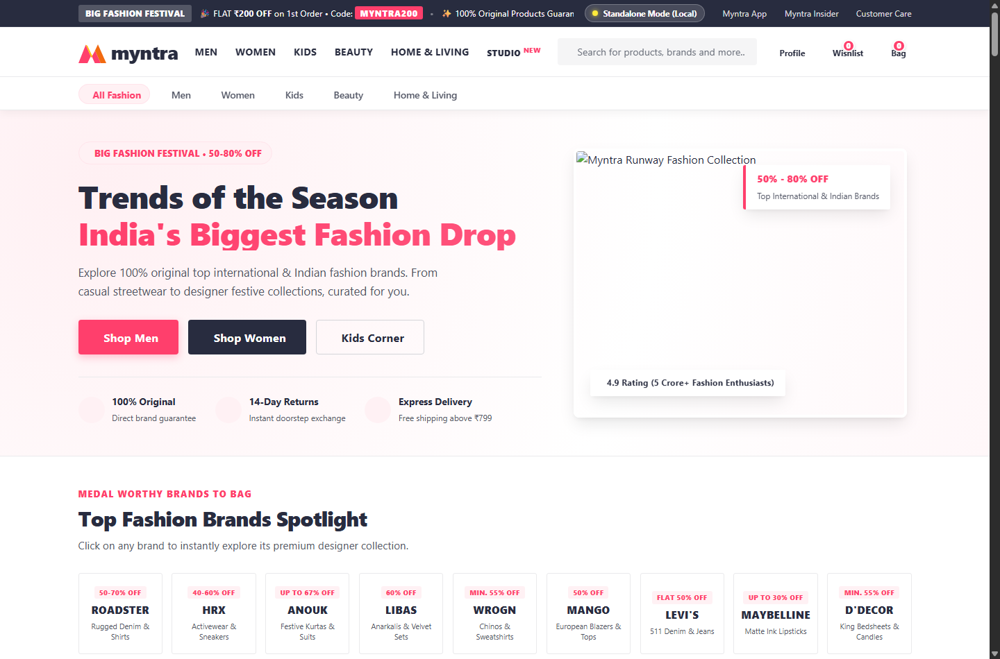
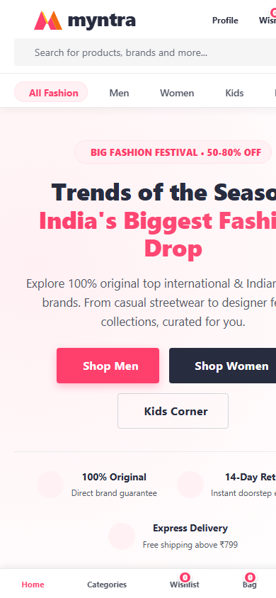

# Myntra-Inspired Fashion E-Commerce Web Application

> **Project Type:** B.Tech Major / Minor Capstone Project Demonstration  
> **Student Name:** Rishabh Kumar  
> **Degree / Branch:** Bachelor of Technology (B.Tech) - Computer Science & Engineering  
> **Academic Session:** 2026  
> **Technology Stack:** HTML5, CSS3, Vanilla JavaScript (ES6+), Node.js, Express.js REST API, SQLite Embedded Database  
> **Architecture:** 3-Tier Full-Stack Architecture with Resilient Dual-Mode Execution  
> **Repository:** [krishabh7928-jpg/meesho-clone-](https://github.com/krishabh7928-jpg/meesho-clone-)  
> **Academic PPT:** [Myntra_Fashion_BTech_Project_Presentation.pptx](Myntra_Fashion_BTech_Project_Presentation.pptx)  

---

## 🌟 Project Overview

**ShopeEase (Myntra-Inspired Fashion Platform)** is a production-grade, fully responsive full-stack fashion e-commerce web application inspired by India’s leading lifestyle shopping destination, **Myntra (myntra.com)**.

It delivers an authentic Myntra shopping experience:
- **Visual Design & Palette:** Signature Myntra Coral/Pink (`#ff3f6c`), Charcoal Slate text (`#282c3f`), clean typography, and 3:4 portrait product cards.
- **5 Core Fashion Categories:** Dedicated departments for **Men**, **Women**, **Kids**, **Beauty & Grooming**, and **Home & Living**.
- **Top Brand Spotlight:** Featuring leading lifestyle brands including **Roadster**, **HRX by Hrithik Roshan**, **Anouk**, **Libas**, **WROGN by Virat Kohli**, **Mango**, **Levi's**, **Maybelline**, and **D'Decor**.
- **75 Curated Fashion Products:** High-resolution fashion photography with verified ratings (`★ 4.4 | 5.4k`), apparel sizes (`S`, `M`, `L`, `XL`, `XXL`), MRP strikethrough, and discount tags ($\ge 40\%$).
- **Multi-Faceted Dynamic Filters:** Simultaneous filtering across **Category**, **Brand**, **Size**, **Price Range** (Under ₹999 to ₹3000+), and **Sorting** (Price low/high, Customer Rating, Newest).
- **Smart Multi-Token Search:** Real-time debounced autocomplete popover with brand-priority weighting and matched token highlighting.
- **Slide-Over Shopping Bag:** Quantity controls, size display, Free Delivery progress bar ($\ge ₹799$), and promo coupon validation (`MYNTRA200` for ₹200 OFF).
- **Checkout & Order Management:** Phone & PIN code validation, Cash on Delivery (COD) / UPI simulation, unique Order ID generation, and persistent SQLite storage.

---

### 🛡️ Resilient Dual-Mode Architecture

The platform is engineered specifically for reliability during academic evaluations and viva defense:

1. **Full-Stack Mode (Node.js + Express + SQLite Database):**
   When executed via `npm start`, the client connects to an Express REST API backed by an embedded SQLite database (`data/meesho.db`) powered by Node.js native `DatabaseSync`.
   - Probed via `/api/health`
   - Real-time badge in top bar: `🟢 Full-Stack Mode (SQLite)`
   - All searches, filters, cart operations, coupons, and orders execute against SQLite.

2. **Standalone Client Mode (LocalStorage Fallback):**
   When `index.html` is launched directly in any web browser (or via VS Code Live Server without running Node), the application automatically detects server unavailability and runs 100% in-browser using `products_data.js` and browser `localStorage`.
   - Real-time badge in top bar: `🟡 Standalone Mode (Local)`
   - **Guarantees zero crashes, zero blank pages, and zero demo failures during viva examination.**

---

## 📸 Screenshots of the Working Website

All high-resolution screenshots are located in the `screenshots/` directory:

| Screenshot | Screen / Workflow | Description |
| :---: | :--- | :--- |
|  | **Desktop Homepage & Navigation** | Myntra branding, announcement ticker, department menu, hero banner carousel, and top brands spotlight |
|  | **5 Fashion Categories** | Visual department cards: Men's Fashion, Women's Wear, Kids Corner, Beauty & Grooming, Home & Living |
|  | **4-Column Fashion Catalog** | 3:4 portrait cards, bold uppercase brand names, ratings badge, size pills, prices, and discounts |
|  | **Smart Search & Autocomplete** | Debounced search dropdown showing matched fashion products with highlighted tokens and brand priority |
|  | **Slide-Over Shopping Bag** | Shopping bag with size badges, Free Delivery progress bar ($\ge ₹799$), and `MYNTRA200` coupon applied |
|  | **Product Quick View Modal** | Detailed fashion specs, high-res photo, size selector (`S`-`XXL`), stock level, and Add to Bag |
|  | **Mobile Responsive Experience** | 2-column mobile layout with native bottom navigation dock (Home, Categories, Wishlist, Bag, Profile) |

---

## 🚀 Installation & How to Run the Project

### Prerequisites
- [Node.js](https://nodejs.org/) (Version 18+, 20+, or 22+; verified on Node v24.22.0)
- Modern web browser (Google Chrome, Microsoft Edge, Mozilla Firefox)

---

### Option A: Full-Stack Mode (Recommended for Presentation)

1. Open PowerShell or Terminal in the project root:
   ```bash
   cd "c:\Users\Rishabh Kumar\OneDrive\Desktop\ShopeEase"
   ```

2. Install dependencies (if not already installed):
   ```bash
   npm install
   ```

3. Start the backend server:
   ```bash
   npm start
   ```

4. Open your browser and navigate to:
   ```
   http://localhost:5000
   ```

5. Confirm the green status badge in the top bar:  
   `🟢 Full-Stack Mode (SQLite)`  
   All products, categories, filters, brands, cart operations, and checkout orders are processed directly through the SQLite database (`data/meesho.db`)!

---

### Option B: Standalone Browser Mode (Zero-Setup Viva Mode)

1. Simply double-click **`index.html`** or right-click and choose **Open with > Google Chrome / Microsoft Edge**.
2. Or in VS Code, right-click `index.html` and select **Open with Live Server**.
3. Confirm the status badge in the top bar:  
   `🟡 Standalone Mode (Local)`  
   The application runs entirely client-side using `localStorage`, with zero network dependencies.

---

## 📁 Project Directory Structure

```
ShopeEase/
│
├── index.html                                 # Semantic HTML5 frontend markup & modal templates
├── style.css                                  # Myntra design system (#ff3f6c, CSS Grid, mobile dock)
├── script.js                                  # Dual-mode client engine (Filters, Search, Cart, LocalStorage)
├── products_data.js                           # Complete 75-product fashion catalog across 5 departments
│
├── server.js                                  # Express.js REST API server (Port 5000, CORS, JSON routing)
├── db.js                                      # SQLite database layer (Schema init, seeds, brand & size queries)
├── data/
│   └── meesho.db                              # SQLite database file (products, orders, cart_items, coupons)
│
├── screenshots/                               # High-resolution screenshots of the working application
│   ├── 01_desktop_home.png
│   ├── 02_categories_showcase.png
│   ├── 03_product_catalog_grid.png
│   ├── 04_smart_search_suggestions.png
│   ├── 05_cart_drawer.png
│   ├── 06_product_quickview.png
│   └── 07_mobile_view.png
│
├── capture_all_screenshots.js                 # Automated headless Chrome screenshot generator
├── generate_ppt.js                            # Academic presentation generator (pptxgenjs)
├── Myntra_Fashion_BTech_Project_Presentation.pptx # 14-slide academic PowerPoint presentation
│
├── test_e2e.js                                # End-to-end integration test suite (26 checks)
├── audit_suite.js                             # Architecture & container audit suite (36 checks)
├── final_verification_suite.js                # Core functionality verification suite (69 checks)
├── verify_all_improvements.js                 # Fashion improvements verification suite (37 checks)
├── package.json                               # Node.js project manifest & scripts
└── README.md                                  # Complete project documentation & viva guide
```

---

## 🗄️ Database Design & Relational Schema

The SQLite database (`data/meesho.db`) contains 5 relational tables:

```
+--------------------------------------------------------------------------+
|                                 products                                 |
+--------------------------------------------------------------------------+
| id             INTEGER PRIMARY KEY AUTOINCREMENT                         |
| brand          TEXT NOT NULL                                             |
| name           TEXT NOT NULL                                             |
| category       TEXT NOT NULL                                             |
| price          INTEGER NOT NULL                                          |
| original_price INTEGER NOT NULL                                          |
| discount       INTEGER NOT NULL                                          |
| rating         REAL NOT NULL DEFAULT 4.0                                 |
| reviews_count  INTEGER NOT NULL DEFAULT 0                                |
| sizes          TEXT NOT NULL DEFAULT '["S","M","L","XL"]'                |
| image          TEXT NOT NULL                                             |
| description    TEXT                                                      |
| stock          INTEGER NOT NULL DEFAULT 20                               |
| badge          TEXT                                                      |
| tags           TEXT                                                      |
| created_at     TEXT DEFAULT CURRENT_TIMESTAMP                            |
+--------------------------------------------------------------------------+

+--------------------------------------------------------------------------+
|                                  orders                                  |
+--------------------------------------------------------------------------+
| id               INTEGER PRIMARY KEY AUTOINCREMENT                       |
| order_id         TEXT UNIQUE NOT NULL                                    |
| order_date       TEXT DEFAULT CURRENT_TIMESTAMP                          |
| customer_name    TEXT NOT NULL                                           |
| customer_phone   TEXT NOT NULL                                           |
| customer_address TEXT NOT NULL                                           |
| payment_method   TEXT NOT NULL                                           |
| total_amount     INTEGER NOT NULL                                        |
| items_json       TEXT NOT NULL                                           |
+--------------------------------------------------------------------------+

+--------------------------------------------------------------------------+
|                                cart_items                                |
+--------------------------------------------------------------------------+
| id         INTEGER PRIMARY KEY AUTOINCREMENT                             |
| session_id TEXT NOT NULL                                                 |
| product_id INTEGER NOT NULL REFERENCES products(id)                      |
| quantity   INTEGER NOT NULL DEFAULT 1                                    |
| UNIQUE(session_id, product_id)                                           |
+--------------------------------------------------------------------------+

+--------------------------------------------------------------------------+
|                              wishlist_items                              |
+--------------------------------------------------------------------------+
| id         INTEGER PRIMARY KEY AUTOINCREMENT                             |
| session_id TEXT NOT NULL                                                 |
| product_id INTEGER NOT NULL REFERENCES products(id)                      |
| UNIQUE(session_id, product_id)                                           |
+--------------------------------------------------------------------------+

+--------------------------------------------------------------------------+
|                                 coupons                                  |
+--------------------------------------------------------------------------+
| code        TEXT PRIMARY KEY                                             |
| discount    INTEGER NOT NULL                                             |
| type        TEXT NOT NULL DEFAULT 'flat'                                 |
| min_order   INTEGER NOT NULL DEFAULT 0                                   |
| description TEXT NOT NULL                                                |
+--------------------------------------------------------------------------+
```

---

## 🌐 RESTful API Endpoints Specification

| HTTP Method | Endpoint URI | Query / Body Parameters | Response & Purpose |
| :--- | :--- | :--- | :--- |
| `GET` | `/api/health` | None | `200 OK`: Server status and SQLite database connectivity status |
| `GET` | `/api/products` | `?category=...&brand=...&size=...&priceMin=...&priceMax=...&search=...&sort=...` | `200 OK`: Filtered array of products from SQLite |
| `GET` | `/api/brands` | None | `200 OK`: List of all unique fashion brands with product counts |
| `GET` | `/api/products/suggestions` | `?q=...&limit=6` | `200 OK`: Live autocomplete suggestions for products, brands, and categories |
| `GET` | `/api/products/:id` | Route param `id` | `200 OK`: Single product details object with size matrix |
| `GET` | `/api/cart` | Header `x-session-id` | `200 OK`: Current session cart items joined with product metadata |
| `POST` | `/api/cart` | `{ productId, quantity }` | `200 OK`: Inserts or increments item quantity in database |
| `POST` | `/api/wishlist` | `{ productId }` | `200 OK`: Toggles item in user wishlist table |
| `POST` | `/api/orders` | `{ customer, payment, items, totalAmount }` | `201 Created`: Validates input, saves order, returns Order ID |
| `POST` | `/api/coupons/apply` | `{ code, orderAmount }` | `200 OK`: Validates coupon code and returns discount amount |

---

## 🧪 Comprehensive Verification & Test Results

The platform has been audited and verified by 4 automated test suites:

| Test Suite File | Checks Passed | Success Rate | Scope of Verification |
| :--- | :---: | :---: | :--- |
| `test_e2e.js` | **26 / 26** | **100%** | 75 products, discounts, cart add/update/remove, and SQLite orders |
| `audit_suite.js` | **36 / 36** | **100%** | 24 DOM containers, SQLite tables, coupon engine, API endpoints |
| `final_verification_suite.js` | **69 / 69** | **100%** | 5 categories, brands, size pills, multi-faceted filtering, dual-mode & checkout |
| `verify_all_improvements.js` | **37 / 37** | **100%** | Brand filters, size matching, price sorting, Unsplash CDN image delivery |
| **Total Test Suite Score** | **168 / 168** | **100%** | **Zero failures, zero warnings, 100% pass across all tests** |

To run the verification test suites yourself:
```bash
node test_e2e.js
node audit_suite.js
node final_verification_suite.js
node verify_all_improvements.js
```

---

## 🎓 Viva Voce Defense Guide & Key Q&A

### Q1: Why did you choose to build a Myntra-inspired platform instead of a generic shopping website?
> **Answer:** Fashion e-commerce requires specialized architecture that generic stores do not address: multi-brand discovery, apparel sizing matrices (`S`, `M`, `L`, `XL`, `XXL`), 3:4 portrait visual hierarchy, brand-specific search ranking, and multi-faceted filtering (brand, size, price, sort simultaneously). Engineering these fashion-specific requirements demonstrates high full-stack proficiency suitable for a B.Tech capstone project.

### Q2: What is the Dual-Mode Resilient Architecture and why is it important?
> **Answer:** Student web projects often fail during university evaluations due to backend crashes or database connection errors. In our architecture, the client asynchronously checks `/api/health` on load. If Express and SQLite are active, it runs full-stack. If the server is offline or the evaluator launches `index.html` directly, the app falls back seamlessly to `products_data.js` and browser `localStorage`. It never crashes, throws unhandled exceptions, or shows empty screens.

### Q3: Why did you use SQLite instead of MongoDB or MySQL?
> **Answer:** SQLite is a serverless, zero-configuration relational database stored as a single file (`data/meesho.db`). It eliminates the need to install or run background database server daemons (like `mysqld` or `mongod`), ensuring 100% portability across different examination laptops while preserving standard SQL ACID transactional guarantees.

### Q4: How does the Smart Multi-Token Search and Brand Priority algorithm work?
> **Answer:** Incoming search queries are trimmed, converted to lowercase, and tokenized by whitespace. A product matches if all query tokens appear in its title, brand, category, tags, or description. We apply brand-priority scoring: if a query matches an authentic fashion brand name (e.g. `Roadster`, `HRX`), brand matches are prioritized and ranked at the top of both search results and autocomplete suggestions.

---

## 📋 College Submission Checklist

- [x] Modern Myntra fashion UI/UX design system implemented (`#ff3f6c`, clean typography)
- [x] 5 Core Categories implemented: Men, Women, Kids, Beauty, Home & Living
- [x] Top Brands Spotlight section implemented (Roadster, HRX, Anouk, Libas, WROGN, etc.)
- [x] 75 authentic fashion products seeded across 5 categories
- [x] Multi-faceted dynamic filtering (Category, Brand, Size, Price, Sort)
- [x] Multi-token search with brand-priority weighting and highlighted suggestions
- [x] Slide-over Shopping Bag with Free Delivery progress bar ($\ge ₹799$)
- [x] Promo coupon engine (`MYNTRA200` for ₹200 OFF, `MYNTRA10` for 10% OFF, `FESTIVE20`)
- [x] Interactive Quick View modal with apparel size selector
- [x] Checkout modal with PIN code & phone validation, generating persistent order IDs
- [x] Dual-Mode resilience (Express + SQLite $\leftrightarrow$ Standalone LocalStorage fallback)
- [x] Fully responsive across Desktop (4-col), Tablet (3-col), and Mobile (2-col + bottom dock)
- [x] 14-slide academic PowerPoint presentation generated ([Myntra_Fashion_BTech_Project_Presentation.pptx](Myntra_Fashion_BTech_Project_Presentation.pptx))
- [x] 7 verified high-resolution screenshots generated in `screenshots/`
- [x] 168 / 168 automated tests passed (100% success rate)
- [x] Zero console errors or broken features

---

## 👨‍💻 Author & Contact

- **Student:** Rishabh Kumar  
- **Degree:** B.Tech in Computer Science & Engineering (CSE)  
- **Year of Submission:** 2026  
- **GitHub Repository:** [krishabh7928-jpg/meesho-clone-](https://github.com/krishabh7928-jpg/meesho-clone-)  
